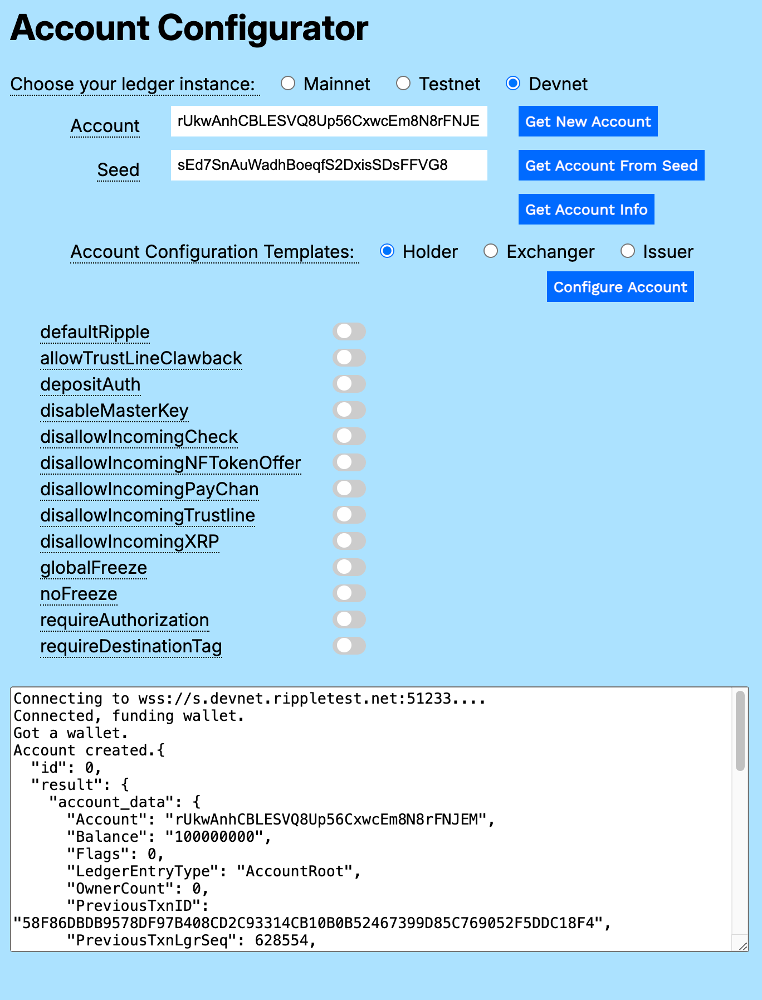
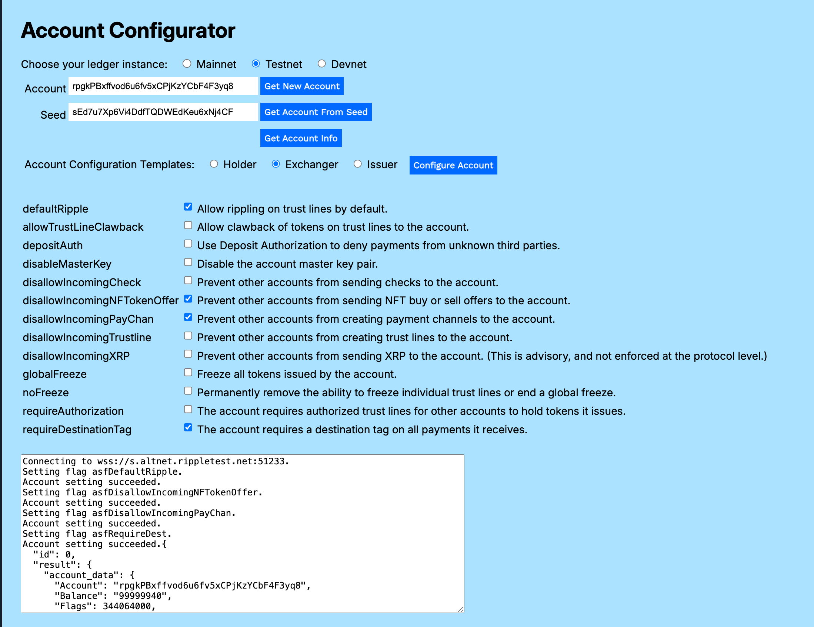
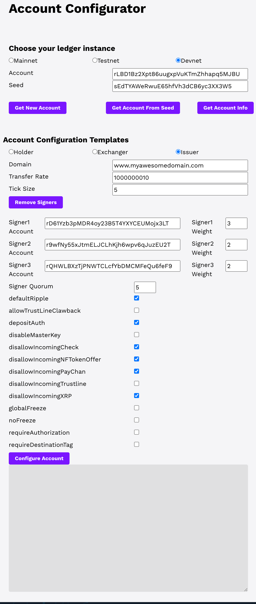
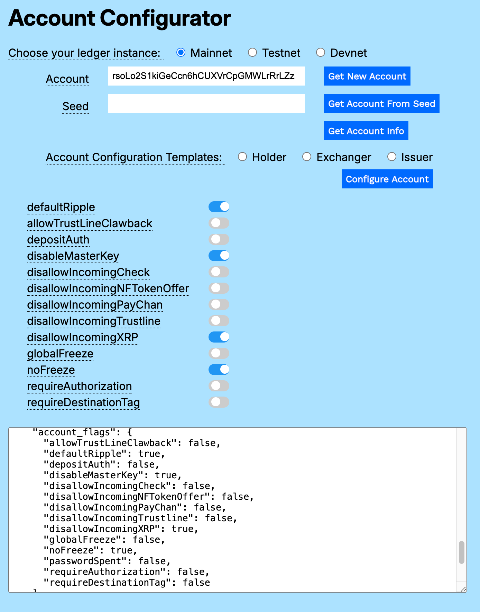
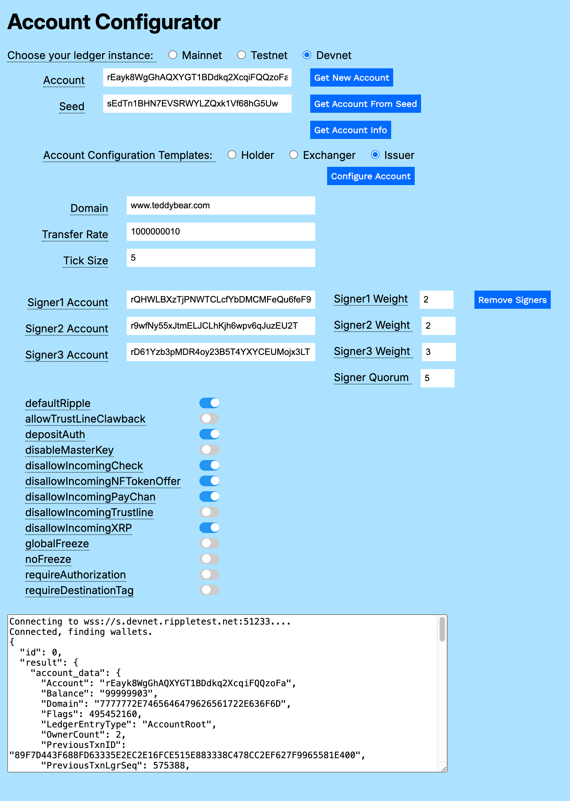

---
seo:
    description: XRP Ledgerアカウントの一般的な設定。
labels:
  - アカウント
  - 設定
---
# アカウントの設定

XRP Ledgerのアカウントには、基本的な設定が3種類あります。

- [Holder](#holder)
- [Exchanger](#exchanger)
- [Issuer](#issuer)

これらのアカウントには、それぞれの機能に応じて異なる運用上およびセキュリティ上の要件があります。まずは、それぞれのユースケースをサポートする特別な動作を設定することから始められます。

[Account Configurator](#account-configuratorの使用)を使用すると、TestnetやDevnetで新しいアカウントを作成し、さまざまな権限や設定を試すことができます。また、Mainnet上のアカウントの情報を取得して、その時点の設定を確認することもできます。

## Holder

主にXRPL上で価値を保有し、使用するアカウントを設定する場合は、新しいアカウントのデフォルトの設定をそのまま使用できます。特別な設定は必要ありません。

## Exchanger

アカウントの主な目的が第三者間の価値の交換を仲介することである場合は、通常、次の4つの設定から始めます。

| フラグ | 説明 |
|------|------|
| `defaultRipple` | デフォルトでトラストラインのRipplingを許可します。あなたが交換を仲介するトークンを、各アカウントが第三者のアカウントと取引するには、Ripplingが必要です。[Rippling](../tokens/fungible-tokens/rippling.md)を参照してください。 |
| `disallowIncomingNFTokenOffer` | 他のアカウントがこのアカウントにNFTの購入オファーや売却オファーを送信できないようにします。これにより、Exchangerアカウントの主な目的と関係のない、求めていないオファーを避けられます。[XRP Ledger上でNFTokenを売買する](../tokens/nfts/trading.md)を参照してください。 |
| `disallowIncomingPayChan` | 他のアカウントがこのアカウントへのPayment Channelを作成できないようにします。自分から他のアカウントへのPayment Channelを作成したい場合はあっても、通常、他のアカウントが取引所のアカウントへのPayment Channelを作成することは望ましくありません。[Payment Channel](../payment-types/payment-channels.md)を参照してください。 |
| `requireDestinationTag` | 受信するすべての支払いに宛先タグを要求します。宛先タグは、共通の受取アカウントにいる特定の顧客に支払いを送るための、より軽量な仕組みです。[送信元タグと宛先タグ](../transactions/source-and-destination-tags.md)を参照してください。 |

## Issuer

トークンを発行するためのアカウントでは、`Account`オブジェクトのフィールドとフラグの両方を設定する必要があります。

### Issuerのフィールド

| フィールド | 説明 |
|----------|------|
| `Domain` | xrp-ledger.tomlファイルを提供するサーバのURLです。`xrp-ledger.toml`ファイルと同じドメインで、人間が読めるウェブサイトも提供することをお勧めします。そのウェブサイトで、あなたが誰であるか、XRP Ledgerをどのように使用しているかについての詳しい情報を提供すると、あなたとあなたのサービスへの信頼を築くのに役立ちます。[xrp-ledger.tomlファイル](../../references/xrp-ledger-toml.md)を参照してください。 |
| `TransferRate` | `TransferRate`の値は、あなたが発行した通貨を取引相手が送金するたびに請求する手数料を指定します。値は10億単位で指定します。例えば、1200000000は20%の送金手数料を表します。値 _0_ と _1000000000_ はどちらもデフォルト（手数料なし）を表すことに注意してください。どちらかの値を明示的に設定した場合、その値は保存されず、デフォルトとみなされます。[送金手数料](../tokens/fungible-tokens/transfer-fees.md)を参照してください。 |
| `TickSize` | `TickSize`の値は、オファーがオーダーブックに登録されるときに、オファーの為替レートの有効桁数を切り捨てます。[ティックサイズ](../tokens/decentralized-exchange/ticksize.md)を参照してください。 |

### 署名者

XRP Ledgerのマルチシグは、複数の秘密鍵を組み合わせてトランザクションを承認する方法です。署名者アカウントのリストを作成し、各署名者アカウントに、相対的な権限を表すウェイトを設定します。署名者の定足数は、トランザクションの承認に必要なウェイトの合計の最小値です。例えば、AshadとBettyの署名者のウェイトがそれぞれ1、Ceresiaの署名者のウェイトが2で、署名者の定足数が3の場合、AshadとCeresiaはトランザクションを承認でき（ウェイトの合計は3）、BettyとCeresiaもトランザクションを承認できます（ウェイトの合計は3）。しかし、AshadとBettyだけではトランザクションを承認できません（2人の署名者のウェイトの合計は2で、必要なウェイトより1少ないため）。[マルチシグ](./multi-signing.md)を参照してください。

### Issuerのフラグ

| フラグ | 説明 |
|------|------|
| `defaultRipple` | デフォルトでトラストラインのRipplingを許可します。このアカウントで発行したトークンを各アカウントが取引するには、Ripplingが必要です。[Rippling](../tokens/fungible-tokens/rippling.md)を参照してください。 |
| `depositAuth` | Deposit Authorizationにより、許可されていない第三者があなたに支払いを送信できないようにします。[Deposit Authorization](./depositauth.md)を参照してください。 |
| `disallowIncomingCheck` | 他のアカウントがこのアカウントにCheckを送信できないようにします。[Checks](../payment-types/checks.md)を参照してください。 |
| `disallowIncomingNFTokenOffer` | 他のアカウントがこのアカウントにNFTの購入オファーや売却オファーを送信できないようにします。これにより、Exchangerアカウントの主な目的と関係のない、求めていないオファーを避けられます。[XRP Ledger上でNFTokenを売買する](../tokens/nfts/trading.md)を参照してください。 |
| `disallowIncomingPayChan` | 他のアカウントがこのアカウントへのPayment Channelを作成できないようにします。自分から他のアカウントへのPayment Channelを作成したい場合はあっても、通常、他のアカウントが取引所のアカウントへのPayment Channelを作成することは望ましくありません。[Payment Channel](../payment-types/payment-channels.md)を参照してください。 |
| `disallowIncomingXRP` | 他のアカウントがこのアカウントにXRPを送信できないようにします。（これは勧告的なもので、プロトコルによって強制されるものではありません。）[XRPによる直接支払い](../payment-types/direct-xrp-payments.md)を参照してください。 |

## その他の設定フラグ

どの設定フラグも、特定のユースケースで役立ちます。以下は、標準的なHolder、Exchanger、Issuerの設定では使用されないアカウント設定フラグです。

| フラグ | 説明 |
|------|------|
| `allowTrustLineClawback` | アカウントが発行したトークンを回収できるようにします。[トークンの回収](../tokens/fungible-tokens/clawing-back-tokens.md)を参照してください。 |
| `disableMasterKey` | マスターキーペアの使用を禁止します。レギュラーキーや署名者リストなど、トランザクションに署名する別の方法をアカウントに設定している場合にのみ有効にできます。[マスターキーペア](./cryptographic-keys.md#マスターキーペア)を参照してください。 |
| `disallowIncomingTrustLine` | 受信するトラストラインをブロックします。これには、あなたのトークンを受け取るために`OfferCreate`トランザクションが暗黙的に作成するはずのトラストラインも含まれます。  |
| `globalFreeze` | このアカウントが発行したすべてのトークンをフリーズします。[Global Freeze](../tokens/fungible-tokens/freezes.md#global-freeze)を参照してください。 |
| `noFreeze` | 個々のトラストラインをフリーズする機能と、Global Freezeを終了する機能を永久に放棄します。[トークンのフリーズ](../tokens/fungible-tokens/freezes.md)を参照してください。 |
| `requireAuthorization` | 他のアカウントがこのアカウントの発行したトークンを保有するには、認可トラストラインが必要になります。[認可トラストライン](../tokens/fungible-tokens/authorized-trust-lines.md)を参照してください。 |

## Account Configuratorの使用

[Account Configurator](/_code-samples/account-configurator/js/account-configurator.zip)のコピーは、`_code-samples`ディレクトリからダウンロードできます。

アーカイブを展開し、ブラウザのウィンドウで`account-configurator.html`を開きます。

### アカウント情報の取得

Account Configuratorを使用すると、Mainnet、Testnet、Devnet上のアカウントの情報を確認できます。

アカウント情報を取得するには:

1. アカウントのレジャーインスタンス（ _Mainnet_ 、 _Testnet_ 、 _Devnet_ のいずれか）を選択します。
2. **Account**フィールドにアカウントのアドレスを入力します。
3. **Get Account Info**をクリックします。

レスポンスは**Results**フィールドに表示されます。

### 新しいアカウントの取得

 _Testnet_ または _Devnet_ 上で、サンドボックス用のアカウントを作成できます。 _Mainnet_ 上でアカウントを作成するには、[アカウントの作成](./index.md#アカウントの作成)を参照してください。

新しいアカウントを取得するには:

1. アカウントのレジャーインスタンス（ _Testnet_ または _Devnet_ ）を選択します。
2. **Get New Account**をクリックします。

後でアカウントを簡単に取得し直せるように、新しいアカウントの**Seed**の値を必ず控えておいてください。

### シードからのアカウントの取得

シードの値から、既存のアカウントの情報を再読み込みできます。

シードからアカウントを取得するには:

1. アカウントのレジャーインスタンス（ _Testnet_ または _Devnet_ ）を選択します。
2. **Seed**フィールドに値を入力します。
3. **Get Account From Seed**をクリックします。

### Holderアカウントの設定

Holderアカウントには設定は必要ありません（デフォルトの設定）。以前にアカウントの設定を変更している場合は、その変更を元に戻して、アカウントをデフォルトの状態に戻せます。

Holderアカウントを設定するには:

1. アカウントのレジャーインスタンス（ _Testnet_ または _Devnet_ ）を選択します。
2. **Get New Account**をクリックするか、次の操作を行います。
   1. **Seed**フィールドに既存のシードの値を入力します。
   2. **Get Account From Seed**をクリックします。
3. **Account Configuration Template**で _Holder_ を選択します。
4. **Configure Account**をクリックします。

アカウントの設定を一度も変更していない場合、**Results**フィールドに表示されるレスポンスは、わずかなトランザクション手数料が差し引かれていることを除いて、元のアカウント情報と同じです。

### Exchangerアカウントの設定

標準的なExchangerアカウントの設定に必要なのは、4つのフラグだけです。

Exchangerアカウントを設定するには:

1. アカウントのレジャーインスタンス（ _Testnet_ または _Devnet_ ）を選択します。
2. **Get New Account**をクリックするか、次の操作を行います。
   1. **Seed**フィールドに既存のシードの値を入力します。
   2. **Get Account From Seed**をクリックします。
3. **Account Configuration Template**で _Exchanger_ を選択します。
   設定フラグのチェックボックスが、4つの標準的な設定に更新されます。必要に応じて設定を増やしたり減らしたりして、アカウントをカスタマイズできます。
4. **Configure Account**をクリックします。

### Issuerアカウントの設定

追加のフィールドを入力し、必要なフラグを選択して、Issuerアカウントを設定します。

Issuerアカウントを設定するには:

1. アカウントのレジャーインスタンス（ _Testnet_ または _Devnet_ ）を選択します。
2. **Get New Account**をクリックするか、次の操作を行います。
   1. **Seed**フィールドに既存のシードの値を入力します。
   2. **Get Account From Seed**をクリックします。
3. **Account Configuration Template**で _Issuer_ を選択します。
   設定フラグのチェックボックスが、6つの標準的な設定に更新されます。必要に応じて設定を増やしたり減らしたりして、アカウントをカスタマイズできます。
4. **Domain**に、`xrp-ledger.toml`が置かれているサーバのURLを入力します。人間が読める形式のURLを入力しますが、アカウント情報を取得すると16進数の文字列に変換されて表示されることに注意してください。アカウントを再設定する場合は、**Domain**のURLを入力し直す必要があります。
5. **Transfer Rate**に、あなたが発行した通貨を取引相手が送金するたびに請求する手数料の割合を入力します。
6. **Tick Size**を入力します。これにより、取引の為替レートの有効桁数が切り捨てられます。
7. 署名者を含める場合、このサンプルモジュールでは、**Signer1 Account**、**Signer2 Account**、**Signer3 Account**に有効なアカウントIDを入力し、それぞれの**Signer Weight**と、**Signer Quorum**の値を入力する必要があります。
8. **Configure Account**をクリックします。

### 署名者の削除

**Remove Signers**をクリックすると、現在のアカウントのすべての署名者が削除されます。


