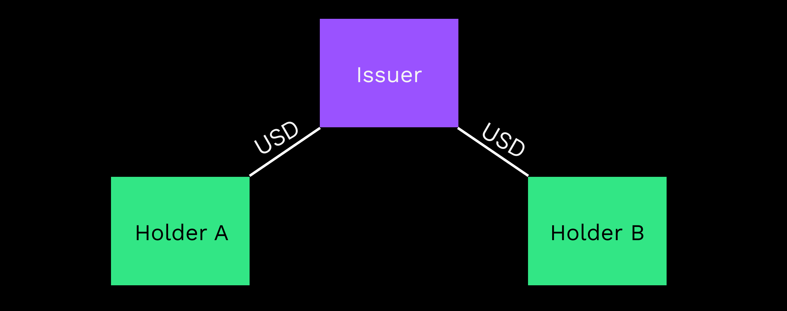
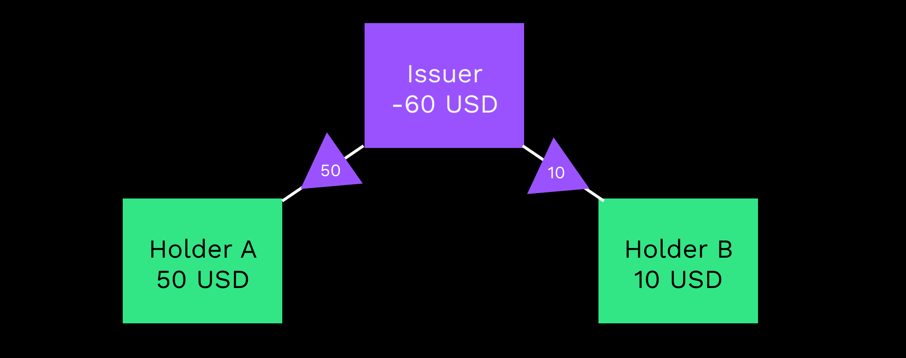
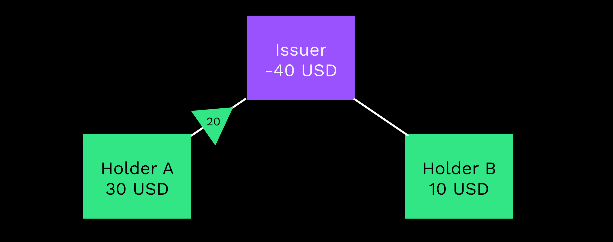
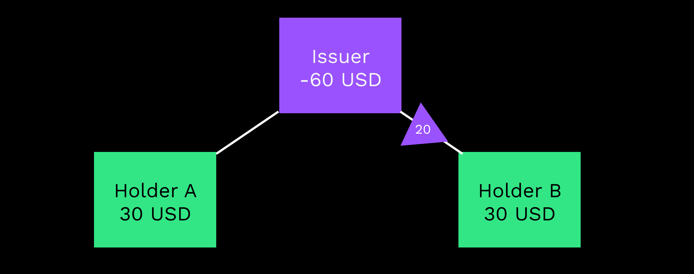
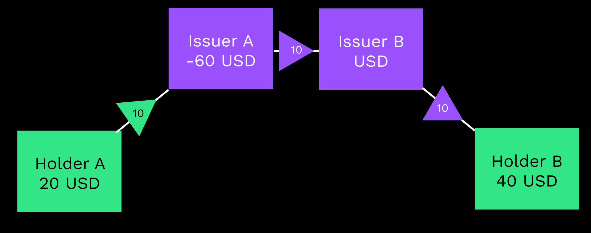
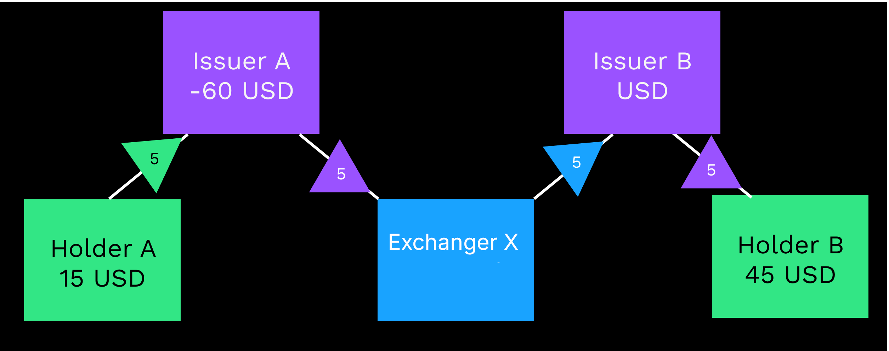

# Rippling

Ripplingとは、[トラストライントークン](./trust-line-tokens.md)の支払いで発生する資金の _間接的な移動_ です（発行アカウントが別のアカウントと直接トークンをやり取りする場合を除きます）。これには、ある保有者が同じトークンの別の保有者にトークンを送る場合も含まれます。

Ripplingでは、通貨コードが同じであれば、発行者が異なるトークン同士でも自動的に交換できます。これにより、アカウント間のより長く複雑な支払いが可能になります。

[MPT](./multi-purpose-tokens.md)は、意図的にRipplingをサポートしていません。

## Ripplingの例

発行者は、トラストラインを通じて保有者に通貨を配布します。保有者が特定のトークンについて発行者へのトラストラインを作成すると、その保有者はそのトークンによる支払いを受け入れることになります。たとえば次の図では、保有者Aと保有者Bの両方が、USDトークンの発行者へのトラストラインを持っています。

発行者は、保有者Aに50 USDを、保有者Bに10 USDを送金します。これらのトラストラインにおける発行者の正味残高は-60 USDになります。

両方のアカウントがUSDトークンによる支払いを受け入れるため、保有者Aは保有者Bに20 USDを支払うことができます。これは1つのトランザクションのように見えますが、実際には2つのステップで行われます。保有者Aの残高は20 USD減り、保有者Bの残高は20 USD増えます。しかし、その裏では、発行者へのトラストラインの保有者A側が20 USD減ります。トラストラインの発行者側は20 USD増え、発行者の正味残高は-40 USDになります。

次に、保有者Bへのトラストラインの発行者側が20 USD減り、保有者Bのアカウントが20 USD増えます。

トークンは発行者を通じて移動しますが、最終的に発行者の残高は変わりません。このトークンの流れを _Rippling_ と呼びます。保有者同士がトークンを送金できるように、発行アカウントはRipplingを許可する必要があります。

XRP Ledgerがトークンを送金するためのパスを見つける際、Ripplingには複数のアカウントが関わることがあります。たとえば、互いにトラストラインを持つ2つの発行者アカウントの間をトークンが流れることがあります。

また、トークンが仲介役のエクスチェンジャーアカウントを経由して保有者に届くこともあります。

流動性プロバイダーや通常の保有者など、その他のアカウントはRipplingを許可すべきではありません。Ripplingを許可すると、残高が予期せず移動したり、トークンがより高いレートで割り当てられたり、保有者が関与していないトランザクションで価値を失ったりする悪用につながる可能性があります。

## DefaultRippleフラグ

DefaultRippleフラグは、すべての受信トラストラインでRipplingを有効にするアカウントレベルの設定です。DefaultRippleフラグのデフォルトはfalseです。顧客同士がトークンを送金できるようにするには、発行者がこのフラグを有効にする必要があります。

DefaultRipple設定は、あなたが作成するトラストラインには影響せず、他者があなたのアカウントに対して開いたトラストラインにのみ影響します。設定を変更しても、変更前に作成されたトラストラインでは既存のNoRipple設定が維持されます。トラストラインのNoRipple設定をアカウントの新しいデフォルトに合わせるには、[TrustSetトランザクション][]を使用します。

## NoRippleフラグ

Ripplingを許可したくないアカウントは、NoRippleフラグを有効にできます。2つのトラストラインでNoRippleフラグを有効にすると、他のアカウントは、その2つのトラストラインの組み合わせを使ってあなたのアカウントを通じて支払いをRipplingさせることができなくなります。ただし、NoRippleフラグが有効になっていない他のトラストラインがある場合は、関係するトラストラインの _いずれか_ でNoRippleが有効になっていなければ、支払いがあなたのアカウントを通じてRipplingされることがあります。

### NoRippleを使用する

NoRippleフラグは、トラストライン上のアドレスの残高がプラスまたはゼロの場合にのみ有効にできます。これは、この機能を悪用して、トラストラインの残高が表す債務を消せないようにするためです。

NoRippleフラグを有効にするには、`tfSetNoRipple`フラグを指定した[TrustSetトランザクション][]を送信します。NoRippleフラグを無効にするには、`tfClearNoRipple`フラグを指定したTrustSetトランザクションを送信します。

### NoRippleステータスの確認

相互に信頼し合う2つのアカウントの場合、NoRippleフラグはアカウントごとに個別に管理されます。

HTTP / WebSocket APIまたはお好みのクライアントライブラリで、`account_lines`メソッドを使ってトラストラインを確認します。各トラストラインの`no_ripple`フィールドは、現在のアドレスがそのトラストラインでNoRippleフラグを有効にしているかどうかを示します。`no_ripple_peer`フィールドは、取引相手がNoRippleフラグを有効にしているかどうかを示します。

## 関連項目

- **コンセプト:**
    - [パス](paths.md)
- **ユースケース:**
    - [ステーブルコインの発行者](../../../use-cases/tokenization/stablecoin-issuer.md)
- **リファレンス:**
    - [account_linesメソッド][]
    - [account_infoメソッド][]
    - [AccountSetトランザクション][]
    - [TrustSetトランザクション][]
    - [AccountRootのフラグ](../../../references/protocol/ledger-data/ledger-entry-types/accountroot.md#accountrootのフラグ)
    - [RippleState（トラストライン）のフラグ](../../../references/protocol/ledger-data/ledger-entry-types/ripplestate.md#ripplestateのフラグ)


