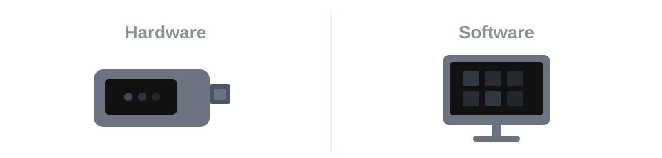

# 加密货币钱包

加密货币钱包为您提供了在 XRP Ledger 上管理账户和资金的方式。可供选择的钱包有很多。选择合适的钱包，最终取决于您的需求以及您使用 XRP 的熟悉程度。

## 托管钱包与非托管钱包

选择钱包时的一个主要因素是：您想要托管钱包还是非托管钱包。

|  | 托管钱包 | 非托管钱包 |
|---|---|---|
| **您的密钥** | 由第三方持有 | 仅由您本人持有 |
| **恢复** | 可重置密码 | 密钥丢失后无法恢复 |
| **交易** | 仅限其平台允许的交易 | 账本允许的任何交易 |
| **安全风险** | 目标更大，持有大量用户的资金 | 由您自行管理密钥安全 |

托管钱包是指由第三方持有您的资金，通常存放在该第三方在 XRP Ledger 上管理的账户中。托管钱包可以看作类似于银行，您信任另一个实体来保障您资金的安全。许多中心化交易所都提供托管钱包，因此，当您在这些交易所创建账户并使用其应用时，从技术上讲，您在账本上并没有自己的账户。

对于日常支付而言，这可能是更好的选择，因为这类钱包对用户友好：如果您忘记了密码，通常可以重置。此外，如果您没有独立的 XRP Ledger 账户，账本的准备金要求就不适用于您。托管方可以作为您在 XRP Ledger 上遇到的任何问题的缓冲，并且在您不确定如何操作时可能会提供支持或帮助。

非托管钱包（例如 [Xaman](https://Xaman.app/)）是指由您持有账户密钥的钱包。这意味着您最终需要自行负责管理账户的安全。

如果您丢失了密钥，您将无法访问您的 XRP Ledger 账户，并且没有任何恢复方法。

非托管钱包提供了更多自由。由于您是直接与 XRP Ledger 交互，您可以执行任何您想要的交易类型，而不会有任何人限制您的选择。只要账本允许，您就可以执行。非托管钱包也不要求您将资金托付给某个机构，这可以使您免受自身无法控制的市场因素的影响。

托管钱包和非托管钱包的用户都必须防范可能试图窃取其资金的恶意用户。使用托管钱包时，您需要管理应用或网站的登录名和密码；使用非托管钱包时，您需要管理链上账户的密钥。无论哪种情况，钱包提供方自身的安全措施对于保护您免受漏洞影响也很重要，例如供应链攻击，即攻击者通过软件更新或依赖项将恶意代码植入钱包。然而，托管钱包可能会成为攻击者更大的目标，因为攻击者可以直接接触到多个客户的资金。

## 硬件钱包与软件钱包

选择钱包时的另一个决定因素是在硬件钱包和软件钱包之间做出选择。

|  | 硬件钱包 | 软件钱包 |
|---|---|---|
| **存储** | 密钥存储在物理设备上 | 密钥以数字形式存储在您的设备上 |
| **安全性** | 不使用时可断开互联网连接 | 安全性较低，始终连接互联网 |
| **优势** | 密钥从不接触电脑或智能手机 | 提供增强使用体验的附加功能 |
| **易用性** | 需要随身携带物理设备 | 更易于使用，随时可访问 |

硬件钱包是存储您私钥或密钥的物理设备。使用硬件钱包的主要好处是，您可以在不使用时将其与互联网断开，从而保护您的信息安全；硬件钱包将您的密钥与更容易被入侵的电脑或智能手机完全隔离。

而软件钱包则完全是数字化的。虽然这使其更易于使用，但也使其成为两者中安全性较低的一种方式，不过软件钱包通常会提供增强使用体验的附加功能。最终，在两者之间如何选择，取决于您的熟悉程度以及您对易用性的重视程度。

## 创建您自己的钱包

XRP Ledger 是一个开源项目，提供公开可用的客户端程序库和 API 方法。虽然从技术上讲，您可以使用 HTTP / WebSocket 工具与账本交互，但这对于日常使用来说并不实际。您可以创建自己的钱包来与账本交互，但在选择这一方案之前，您需要准确理解账户、交易和账本是如何协同工作的。

下一篇：[交易与请求](transactions-and-requests.md)

## 另请参阅

有关 XRP Ledger 支持哪些钱包的更多信息，请参阅[钱包](../../about/xrp.page.tsx#wallets)。
