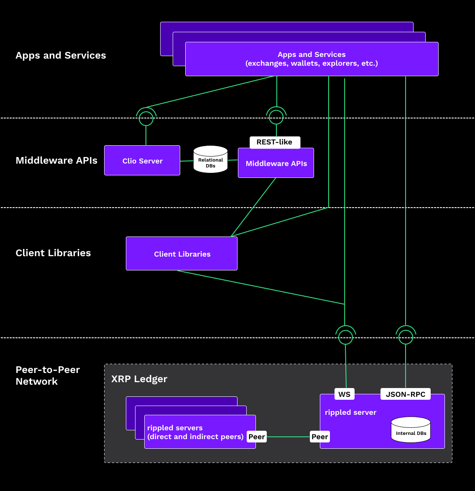
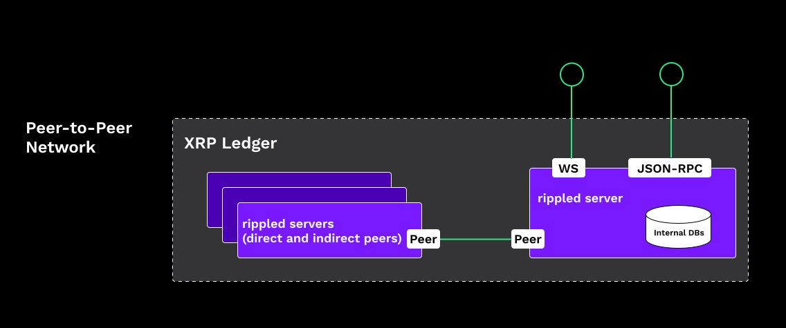
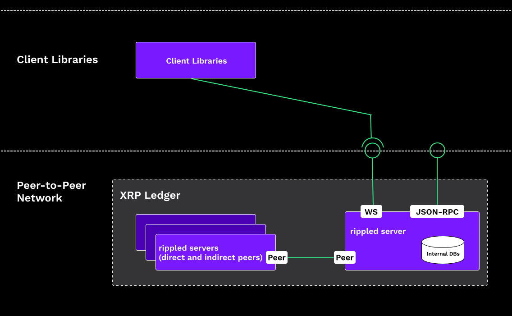
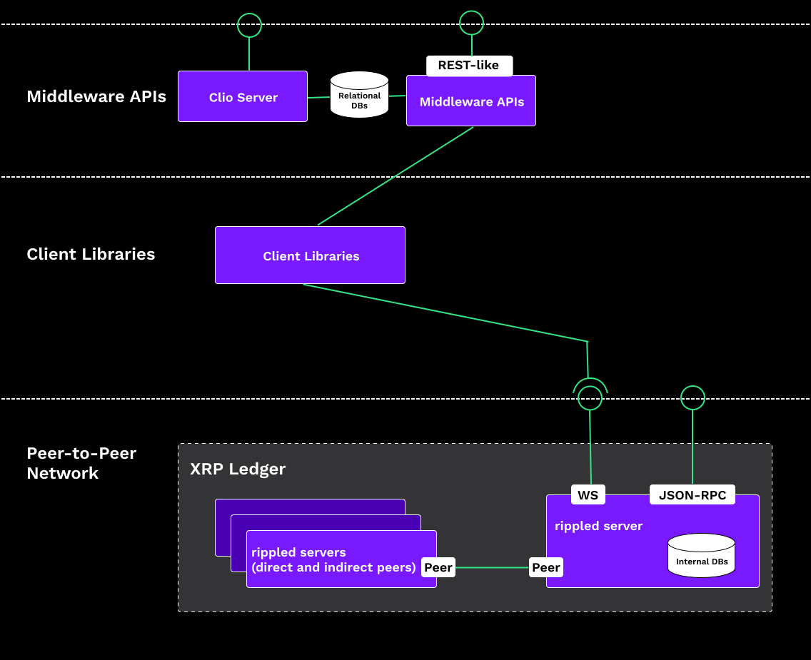

# 软件生态系统

XRP Ledger 拥有一个深厚且分层的软件项目生态系统，这些项目为价值互联网提供动力并使其成为可能。与 XRP Ledger 交互的项目、工具和企业不胜枚举，因此本页仅列出几个类别，并重点介绍本网站上有文档记录的一些核心项目。

## 技术栈层级

- [_核心服务器_](#核心服务器)构成了 XRP Ledger 的基础，这是一个始终在中继和处理交易的点对点网络。

- [_客户端程序库_](#客户端程序库)存在于更高层级的软件中，被直接导入到程序代码中，并包含访问 XRP Ledger 的方法。

- [_中间件_](#中间件)提供对 XRP Ledger 数据的间接访问。这一层中的应用通常拥有自己的数据存储和处理能力。

- [_应用与服务_](#应用与服务)提供用户层面与 XRP Ledger 的交互，或为更高层级的应用与服务提供基础。

### 核心服务器

XRP Ledger 核心的点对点网络需要一个高度可靠、高效的服务器来执行共识规则和交易处理规则。XRP Ledger Foundation 发布了该服务器软件的参考实现，名为 [**`rippled`**](../concepts/networks-and-servers/index.md)（读作“ripple-dee”）。该服务器基于提供，因此任何人都可以检查和修改自己的服务器实例，并在极少限制的情况下重新发布。

每个核心服务器都会同步到同一个网络（除非将其配置为跟随某个[测试网络](../concepts/networks-and-servers/parallel-networks.md)），并且可以访问整个网络中的所有通信。网络中的每个服务器都会保存整个 XRP Ledger 最新状态数据的完整副本，以及近期的交易和这些交易所做更改的记录；每个服务器都会独立处理每一笔交易，同时验证其结果与网络其余部分一致。服务器可以配置为保存更多的[账本历史](../concepts/networks-and-servers/ledger-history.md)，并作为[验证者](../concepts/networks-and-servers/xrpld-server-modes.md#validators)参与共识流程。

核心服务器提供 [HTTP / WebSocket API](../references/http-websocket-apis/index.md)，供用户查询数据、管理服务器和提交交易。Clio 服务器同样提供 HTTP / WebSocket API，但它们不直接连接到点对点网络，也不处理交易或参与共识。这些服务器依赖处于 P2P 模式的核心服务器来处理交易。

### 客户端程序库

客户端程序库通常通过 HTTP / WebSocket API，简化访问 XRP Ledger 的一些常见工作。它们会将数据转换为各种编程语言更熟悉、更便于使用的形式，并包含常见操作的实现。

大多数客户端程序库的一项核心功能是在本地签署交易，这样用户就永远不必通过任何网络发送自己的私钥。

许多中间件服务在内部使用客户端程序库。

有关当前可用客户端程序库的一些信息，请参阅[客户端程序库](../references/client-libraries.md)。

### 中间件

中间件服务是一类程序，它们在一端使用 XRP Ledger API，在另一端提供自己的 API。中间件通过以服务的形式提供一些通用功能，提供了一个抽象层，使构建更高层级的应用变得更加容易。

客户端程序库会随导入它们的程序一起实例化和关闭，而中间件服务则不同，它们通常会持续运行，并且可能拥有自己的数据库（关系型 SQL 数据库或其他类型的数据库）和配置文件。有些中间件以云服务的形式提供，并有不同的定价或使用限制。

### 应用与服务

技术栈的顶层是真正激动人心的事情发生的地方。应用与服务为用户和设备提供了连接 XRP Ledger 的途径。私有交易所、代币发行方、交易市场、去中心化交易所的接口以及钱包等服务，提供了用于买入、卖出和交易各种资产（包括 XRP 和各类代币）的用户界面。此外还存在许多其他可能性，包括构建在更高层级之上的其他服务。

有关可以在这一层或更高层构建的一些示例，请参阅[用例](../use-cases/index.md)。


