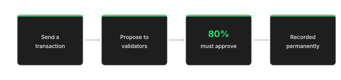

# 交易与请求

与 XRP Ledger 的大多数交互，要么是发送一笔对账本进行更改的交易，要么是发送一个从账本获取信息的请求。您还可以订阅并监控您感兴趣的持续通知。

## 交易如何运作？

使用交易可以对账本进行更改，例如在账户之间转移 XRP 和其他代币；铸造和销毁 NFT；以及创建、接受和取消订单。您可以通过向 XRP Ledger 发送命令来执行交易，并关注交易已完成的确认信息。每种交易的命令语法格式都相同。

- 您必须始终提供 _TransactionType_ 以及发起交易的 _Account_ 的公开地址。

- 两个必填字段是交易的 _Fee_ 以及该账户下一笔交易的 _Sequence_ 编号。这些字段可以自动填写。

- 交易还可能具有特定于该交易类型的必填字段。例如，_Payment_ 交易需要一个 _Amount_ 值（以 _drop_ 为单位，即 XRP 的百万分之一），以及一个用于接收资金的 _Destination_ 公开地址。

以下是一个 JSON 格式的示例交易。该交易从账户 _rf1BiGeXwwQoi8Z2ueFYTEXSwuJYfV2Jpn_ 向目标账户 _ra5nK24KXen9AHvsdFTKHSANinZseWnPcX_ 转移 1 XRP。

```json
{
  "TransactionType": "Payment",
  "Account": "rf1BiGeXwwQoi8Z2ueFYTEXSwuJYfV2Jpn",
  "Amount": "1000000",
  "Destination": "ra5nK24KXen9AHvsdFTKHSANinZseWnPcX"
}
```

所有交易都有可选字段，特定交易还有额外的可用字段。您可以根据需要包含任意数量的可选字段，但不必在每笔交易中都包含所有字段。

您可以通过 JavaScript、Python、命令行或任何兼容的服务，以命令的形式将交易发送到账本。xrpld 服务器会向 XRPL 提议交易。



当 80% 的验证者批准当前这组提议的交易后，这些交易就会被记录为永久账本的一部分。xrpld 服务器会返回您所发送交易的结果。

有关交易的更多信息，请参阅[交易](../concepts/transactions/index.md)。

## 请求如何运作？

请求用于从账本获取信息，但不会对账本进行更改。这些信息对所有人免费开放查看，因此无需使用您的账户信息登录。

您发送的字段因所请求信息的类型而异。请求通常有多个可选字段，但只有少数几个必填字段。

您提交请求后，请求可能由 xrpld 服务器处理，也可能由 Clio 服务器处理。Clio 服务器是专门用于响应请求的服务器。

Clio 服务器分担了 XRPL 上其他 xrpld 服务器的部分负载，从而提高处理速度和可靠性。

以下是一个 JSON 格式的示例请求。该请求获取您所提供账号的当前账户信息。

```json
{
  "command": "account_info",
  "account": "rG1QQv2nh2gr7RCZ1P8YYcBUKCCN633jCn"
}
```

该请求会返回大量信息。以下是一个 JSON 格式的账户信息请求的示例响应。

```json
{
    "result": {
        "account_data": {
            "Account": "rG1QQv2nh2gr7RCZ1P8YYcBUKCCN633jCn",
            "Balance": "999999999960",
            "Flags": 8388608,
            "LedgerEntryType": "AccountRoot",
            "OwnerCount": 0,
            "PreviousTxnID": "4294BEBE5B569A18C0A2702387C9B1E7146DC3A5850C1E87204951C6FDAA4C42",
            "PreviousTxnLgrSeq": 3,
            "Sequence": 6,
            "index": "92FA6A9FC8EA6018D5D16532D7795C91BFB0831355BDFDA177E86C8BF997985F"
        },
        "ledger_current_index": 4,
        "queue_data": {
            "auth_change_queued": true,
            "highest_sequence": 10,
            "lowest_sequence": 6,
            "max_spend_drops_total": "500",
            "transactions": [
                {
                    "auth_change": false,
                    "fee": "100",
                    "fee_level": "2560",
                    "max_spend_drops": "100",
                    "seq": 6
                },
                ... (trimmed for length) ...
                {
                    "LastLedgerSequence": 10,
                    "auth_change": true,
                    "fee": "100",
                    "fee_level": "2560",
                    "max_spend_drops": "100",
                    "seq": 10
                }
            ],
            "txn_count": 5
        },
        "status": "success",
        "validated": false
    }
}
```
有关账户记录中各字段的信息，请参阅[账户](../concepts/accounts/index.md)。

下一篇：[软件生态系统](software-ecosystem.md)
