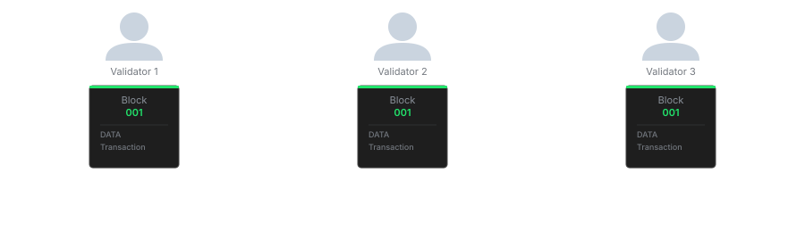
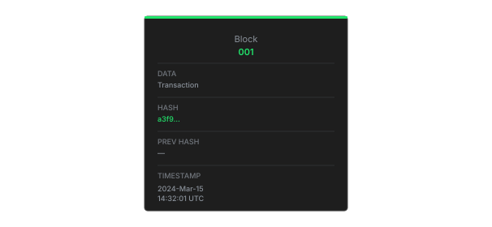
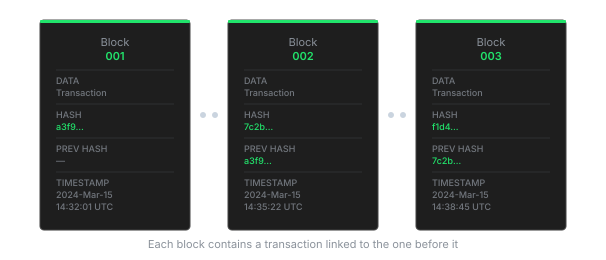
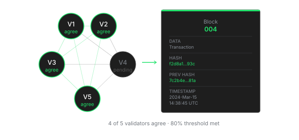

# 什么是 XRP Ledger？

XRP Ledger 是一个去中心化的区块链，它使用自己的数字货币来处理和记录金融交易。

## 什么是区块链？

区块链是一个持续增长的记录列表。区块链从一个数据区块开始。一组受信任的验证者节点就该数据有效达成共识。每个验证者节点都会获得该数据区块的一份副本。区块链中不存在单一的中央机构，所有副本同样有效。

每个区块都由一个非常精密、复杂、由计算机生成的加密哈希值唯一标识，该哈希值长度为 64 个十六进制字符。区块同时还由记录其创建时间的时间戳标识。

每个区块都包含一个哈希指针，作为指向前一个区块的链接。区块中还包含时间戳、新数据以及其自身唯一的哈希值。

借助这种结构，每个区块在链中都有明确的位置，并链接回前一个数据区块，从而形成一条不可篡改的区块链。您始终可以通过回溯之前的区块来验证链上的所有当前信息。

区块链在设计上就能抵御数据篡改。每个账本节点都会获得区块链的一份完全相同的副本。

由此形成一个开放的分布式账本，能够以可验证且永久的方式，高效地记录各方之间的交易。

数据一旦记录，任何区块中的数据都无法被追溯修改，除非大多数验证者同意该修改。如果验证者同意修改，则之后的所有区块都会以相同方式被修改（这种情况极为罕见且极端）。

### 联合共识流程如何运作？

XRPL 中的大多数 xrpld 服务器负责监控或提议交易。其中一个重要的服务器子集作为验证者运行。这些受信任的服务器会将新交易列表汇集到一个新的候选账本实例中（即区块链中的一个新区块）。

它们会与所有其他验证者共享各自的列表。验证者会采纳彼此提议的变更，并分发新版本的账本提案。

当 80% 的验证者就一组交易达成一致时，它们会在链的末端创建一个新的账本实例，然后重新开始该流程。这一共识流程需要 4 到 6 秒。您可以访问 [https://livenet.xrpl.org/](https://livenet.xrpl.org/) 实时查看账本实例的创建过程。

### 有哪些可用的网络？

XRPL 向所有人开放，任何人都可以搭建自己的 xrpld 服务器实例并接入网络。节点可以监控网络、执行交易，或成为验证者。当前运行的 XRPL 网络通常被称为 _主网（Mainnet）_。

对于希望在不投入自有资金的情况下试用 XRPL 功能的开发者或新用户，XRPL 提供了两个开发者环境：_测试网（Testnet）_ 和 _开发网（Devnet）_。用户可以创建一个预存 1,000 个（虚拟的）XRP 的账户，并连接到任一环境与 XRPL 进行交互。

下一篇：[什么是 XRP？](what-is-xrp.md)
