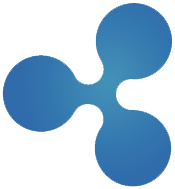

# 什么是 XRP？

XRP 是 XRP Ledger 所支持的加密货币。

## 什么是加密货币？

加密货币是一种通过密码学保障安全、并使用区块链进行追踪的数字货币或虚拟货币。加密货币的安全性和完整性使其几乎不可能被伪造或双重支付。

[](/docs/img/xrp-on-blockchain.svg)

加密货币、数字货币和数字资产都属于同一大类。它们具有以下共同特性：

<link rel="stylesheet" href="https://cdn.jsdelivr.net/npm/@tabler/icons-webfont@3.19.0/dist/tabler-icons.min.css"/>

  
<i class="ti ti-world"></i>为互联网而生

  
<i class="ti ti-lock"></i>不可篡改

  
<i class="ti ti-bolt"></i>快速且低成本

  
<i class="ti ti-shield-check"></i>无法伪造

  
<i class="ti ti-topology-star-3"></i>无中央机构

  
<i class="ti ti-code"></i>可编程

  
<i class="ti ti-eye"></i>开放透明

  
<i class="ti ti-map-off"></i>无国界

  
<i class="ti ti-file-check"></i>规则不会一夜改变

  
<i class="ti ti-ban"></i>抗审查

  
<i class="ti ti-building-bank"></i>无需银行

  
<i class="ti ti-arrows-exchange"></i>无需境外账户

加密货币属于 _同质化代币_。_同质化_ 是指您可以用等值的其他代币替换某一个代币。邮资就是同质化代币的一个例子：如果寄一封信需要 50 美分，您可以使用 2 张 25 美分的邮票或 5 张 10 美分的邮票支付邮资，因为邮票是同质化的（相对价值一致且可以互换）。

加密货币也是去中心化的。没有任何中央机构管理这种货币。交易一旦记录在区块链上，就无法更改。加密货币很难被审查：只要系统足够去中心化，任何人都无法回滚交易、冻结余额，或阻止他人使用去中心化的数字资产。如果没有所有参与者之间的充分协调，规则就不会改变。

加密货币之所以吸引投资者和开发者，是因为没有任何单一实体能够“拔掉插头”让它们消失。

## 但它为何有价值？

[](/docs/img/value-from-faith.svg)

加密货币仅基于计算机数据，而不是基于贵金属等任何有形商品，这一点可能看起来有些奇怪。传统上，货币曾以牛、贝壳、稀有金属、石头或其他实物为基础。但这些物品之所以有价值，只是因为某种文化中的人们对此达成了共识。

虽然手里握着“真实”的东西似乎更安全，但很多人分辨不出愚人金和真金，也分辨不出立方氧化锆和真钻石。纸币可能被伪造。您可能会忘记口袋里有一张 10 美元的钞票，结果把它洗坏了。安全地存储和运输用于支付的贵重物品成本也很高。

加密货币的价值来自持有者对该货币的信任。鉴于其记录的分布式特性以及保护资金安全的密码学保障，加密货币可以被视为一种比传统法定货币更稳健、更安全、更便捷的货币形式。

## XRP 是加密货币

XRP Ledger 由 Jed McCaleb、Arthur Britto 和 David Schwartz 于 2011 年至 2012 年初构建。在其创建之时，共有 1,000 亿枚 XRP。2012 年 9 月，Jed 和 Arthur 与 Chris Larsen 共同创立了 Ripple（这家公司当时名为 OpenCoin Inc.），并决定将 800 亿枚 XRP 赠予 Ripple，以换取 Ripple 在 XRP Ledger 上进行开发。

[](/docs/img/xrp-supply-timeline.svg)

此后，该公司定期出售 XRP，利用 XRP 增强 XRP 市场、提升网络流动性，并激励更广泛的生态系统的发展。2017 年，该公司将 [550 亿枚 XRP 置于托管中](https://ripple.com/insights/ripple-escrows-55-billion-xrp-for-supply-predictability/?__hstc=78174987.8aa695b6d0420a940041f1842edfd8a6.1692378128025.1692644550213.1692652561840.8&__hssc=78174987.3.1692652561840&__hsfp=3379522993)，以确保在可预见的未来，进入总体供应的 XRP 数量[以可预测的方式增长](https://ripple.com/insights/ripple-to-place-55-billion-xrp-in-escrow-to-ensure-certainty-into-total-xrp-supply/?__hstc=78174987.8aa695b6d0420a940041f1842edfd8a6.1692378128025.1692644550213.1692652561840.8&__hssc=78174987.3.1692652561840&__hsfp=3379522993)。Ripple 的 [XRP 市场表现网站](https://ripple.com/xrp/?__hstc=78174987.8aa695b6d0420a940041f1842edfd8a6.1692378128025.1692644550213.1692652561840.8&__hssc=78174987.3.1692652561840&__hsfp=3379522993)会报告该公司目前可用及锁定在托管中的 XRP 数量。

### 名称由来

XRP Ledger 最初被称为“Ripple”，因为该技术允许支付[像涟漪一样经过多个跳转和多种货币传递](../concepts/tokens/fungible-tokens/rippling.md)。对于账本内置的原生资产，创建者从“ripple credits”或“ripples”一词中选取了代码“XRP”，并采用了 [ISO 4217](https://www.iso.org/iso-4217-currency-codes.html) 标准中用于非国家货币的前缀 X。

[](/docs/img/xrp-naming.svg)

该公司以“Ripple Labs”的名称注册。为避免与该技术和公司的相似名称混淆，“XRP”这一名称逐渐被用于在所有场合指代该资产，最终该公司也将自己的名称缩短为“Ripple”。2018 年 5 月，社区选定了一个新的“X”符号来代表 XRP，以将其与之前公司和数字资产共用的三螺旋（triskelion）标志区分开来。

| XRP“X”标志                      | Ripple 三螺旋标志                              |
|:-------------------------------:|:----------------------------------------------:|
|  |  |

### 商标

“XRP”是 XRPL Foundation 在美国以及中国、爱沙尼亚等其他国家的注册商标。

该商标申请于 2013 年在美国专利商标局（USPTO）注册，受让人为 OpenCoin Inc 和 Ripple Labs Inc。2022 年，该商标的转让信息已更新，目前转让给 MITTETULUNDUSÜHING XRP LEDGER TRUST（“XRPLF”）。

下一篇：[加密货币钱包](crypto-wallets.md)
