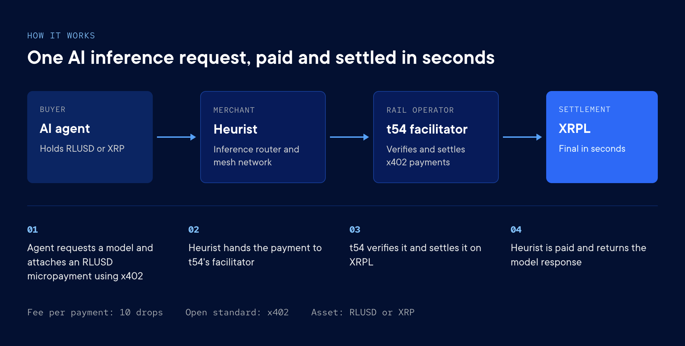

# How Heurist and t54 built a machine scale payments rail on XRPL

Traditional payment rails make sub-cent AI agent transactions economically unviable, with processing fees often exceeding the query cost itself. On the XRP Ledger, high-volume inference queries clear in seconds at just $0.014 per 1,000 calls—making XRPL roughly 75x cheaper than Solana and Base.

**TLDR;**
* 15 million agentic payments have settled on the XRP Ledger in a single year, and volume is still climbing every week.
* Agents settle in both XRP and RLUSD on the rail, through the x402 facilitator t54 built and runs on XRPL.
* Fees are paid in XRP, and they are low and known in advance. 99.37% of payments pay the same 10 drop minimum, about $0.014 per 1,000 agent calls.
* Compliance is built into the ledger. Credentials and Permissioned Domains, live since February 2026, let businesses control which agents can pay which merchants before funds move.

<!-- BREAK -->

**Agentic commerce just crossed 15 million settled transactions on XRP Ledger, with volume still climbing every week.**

Over the past year, 15 million agentic transactions [have settled on the XRP Ledger](https://xrpl-ai.org/), the 7-day average is 134,618 transactions per day and the pace is still climbing every week. Each micropayment clears in seconds, at a minimal protocol cost of 10 drops, regardless of transaction size or volume. 

## The challenge

AI agents need to pay for services, usually at a fraction of a cent, thousands of times a day. Card processing fees can cost more than the payment itself and manual invoicing cannot keep up with that pace.

[Heurist](https://www.heurist.ai/) runs into this problem every day, they connect AI agents to whichever AI model fits their request best. Every single request needs a payment, instantly, at scale. Heurist's RLUSD settlements through [t54's](https://www.t54.ai/) x402 facilitator alone have seen 10 million transactions.

## The solution

Heurist settles these payments on XRPL using RLUSD and the x402 standard, through the XRPL facilitator built by t54.

### How it works

* **XRPL** is the settlement layer. Payments settle here in seconds, for a fraction of a cent.

* **Heurist** is the merchant. It gets paid every time an agent uses its inference router or mesh network. Heurist operates two endpoints on the XRPL rail. Heurist Inference Router has settled millions of transactions. 

* **t54** is the rail operator. It built and runs the facilitator that verifies and settles payments between agents and merchants on chain. 

* **x402** is the open payment standard that both companies build on. It started as a Coinbase project before moving to the Linux Foundation in April 2026. Ripple joined the Linux Foundation as a Premier member in July 2026 as a contributor and governance participant in the standard.

When an agent needs to run a model, agents transact in XRP and RLUSD. The payment settles immediately.

## The volume so far

The volume on XRPL is climbing week over week, as more merchants and agents join the rail. It also tracks a broader shift in what agents are buying. Between June and August 2026, AI model calls became the fastest growing category of agentic payment, accounting for 62 percent of payments and nearly doubling every month.

"_The agentic economy opens up a new market for developers: agents that need their services can also become paying customers. Heurist shows what this looks like for AI inference: agents pay per request on the XRP Ledger through t54's x402 facilitator. XRPL's low transaction costs help make even small, frequent payments practical. That gives developers a foundation to build services around what agents need and earn revenue as those services are used._" Chandler Fang, Founder, t54 Labs.

## Why XRPL is the right rail for this

1. **It is cheaper.** XRPL processes agent payments for $0.0000137 each. 1,000 agent calls costs $0.014 on XRPL, versus $1.03 on Solana and $1.08 on Base. Making it roughly 75x to 79x less expensive than Solana and Base. That gap is a real margin advantage for developers running high volume transactions.

2. **Currency conversion happens in one step.** XRPL is the only chain among its peers where an agent can hold XRP and pay a merchant in RLUSD in a single, atomic transaction. No bridge, no extra step, no added fee. For developers building agents that transact in different currencies, this removes a whole layer of complexity they would otherwise have to build themselves.

3. **The cost is predictable.** Nearly all (99.37%) payments on XRPL pay the exact same tiny protocol minimum of 10 drops. Teams and agents know their cost before they send a single transaction.

4. **Compliance is built into the rail.** Credentials and Permissioned Domains have been live on XRPL since February 2026. A business can define exactly which agents are allowed to pay which merchants, before any money moves. This is a differentiated capability today, and it means compliance can be designed into the payment layer rather than added after the fact.

**XRPL enabled Heurist to scale to 9 million transactions without ever changing its payment stack.**

"_Heurist and t54 have settled millions of sub-cent AI inference payments on XRPL, in real time. We are focused on making XRP and RLUSD first class options wherever developers are building agentic commerce. The updated [XRPL AI Starter Kit](https://xrpl.org/docs/agents/agentic-transactions) makes it easier for developers to build on these open standards and get to production faster._" Jasmine Cooper, Head of Product, RippleX.

Whether you are a merchant looking to monetize AI services automatically or a developer building autonomous agents, building on XRPL means access to a full stack and a battle-tested rail designed for production-scale volume. By leveraging open standards like x402 alongside XRP and RLUSD, teams can eliminate billing friction, streamline cross-currency settlements, and launch production-ready payment workflows faster than ever.

Get started

**For Merchants:** Ready to monetize your AI services with agentic micro-transactions like Heurist? Register your service on the XRPL rail or join as a facilitator partner at https://xrpl-ai.org/join/service.

**For Developers:** Start building autonomous agent payment workflows today using the XRPL AI Starter Kit and open x402 standards. https://xrpl.org/docs/agents/agentic-transactions

